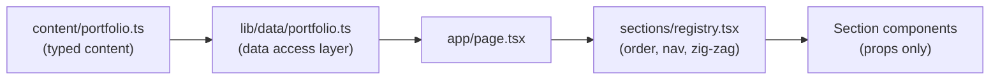

# 🌌 Portfolio — Vatsal Patel

A fast, accessible, single-page developer portfolio built with Next.js (App Router), TypeScript and Tailwind CSS v4. The dark theme is a night sky; the light theme is a faint star chart.

* * *

## ✨ Features

### 🔭 Astronomy theme
- **Starfield backdrop:** twinkling, parallax stars; the cursor draws constellations and shooting stars cross the dark sky.
- **Code constellation:** the hero shows core technologies as stars, linked like a dependency graph.
- **Orrery:** a CSS-only solar system sits behind the contact section.
- **Respectful motion:** everything pauses when the tab is hidden and goes static under `prefers-reduced-motion`.

### 🧭 Layout and UX
- **Zig-zag sections:** title rails alternate left and right on large screens and stack on small ones.
- **Responsive:** works from 320px phones to ultrawide monitors; the hero heading always stays on one line.
- **Navigation:** sticky header with scrollspy, a mobile drawer, and a skip link.
- **Quick actions:** resume download and a copy-email button.

### 🚀 Engineering
- **Server-first:** Server Components by default; client JavaScript only for scrollspy, the drawer, the theme toggle, the copy button and the starfield.
- **SEO:** metadata, Open Graph/Twitter cards, JSON-LD, sitemap and robots. Only production is indexable.
- **Security:** strict CSP (no third-party origins), HSTS and other hardening headers.
- **Data-driven:** all copy lives in one typed file; sections are rendered from a registry.
- **Tested:** unit tests for logic and behaviour, Playwright end-to-end tests against the production build, CI on every push.

* * *

## 🏗️ Architecture



Components never import content directly, so the data source can later move to an API without touching the UI. See [ARCHITECTURE.md](ARCHITECTURE.md) for the reasoning behind the main decisions.

* * *

## 📁 Project Structure

```text
src/
├── app/                 # Routes: layout, page, robots, sitemap, OG images, 404, global CSS tokens
├── components/
│   ├── layout/          # Navbar, scrollspy, mobile drawer, footer
│   ├── sections/        # Hero, About, Skills, Experience, Projects, Achievements, Contact + registry
│   └── ui/              # Primitives, icons, RichText, Starfield, CodeConstellation, Orrery
├── config/              # Site URL, indexing rules, SEO defaults
├── content/             # All portfolio copy (single source of truth)
├── lib/                 # Data access layer, JSON-LD builder, utilities
└── types/               # Content contracts
e2e/                     # Playwright specs
public/resume.pdf        # Served by the Resume buttons
```

* * *

## 🚀 Getting Started

### Prerequisites
- Node.js 20.9 or newer
- npm

### Installation
```bash
git clone git@github.com:Vtsl-patel/portfolioBlog.git
cd portfolioBlog
npm install
npm run dev        # http://localhost:3000
```

Content lives in `src/content/portfolio.ts`. To update the resume, replace `public/resume.pdf`.

### Environment
Everything works without configuration. Copy `.env.example` to `.env.local` to override the public site URL (`NEXT_PUBLIC_SITE_URL`) or add a Search Console token.

* * *

## 🛠️ Available Scripts

| Script | Purpose |
|---|---|
| `npm run dev` | Development server |
| `npm run build` | Production build (also type-checks) |
| `npm run start` | Serve the production build |
| `npm run lint` | ESLint |
| `npm run typecheck` | `tsc --noEmit` |
| `npm test` | Unit and component tests (Vitest) |
| `npm run test:e2e` | End-to-end tests (Playwright, against a production build on port 3100) |
| `npm run test:e2e:watch` | Same, in a visible browser, one test at a time (add `PW_SLOWMO=500` to slow it down) |

### 🧪 Testing
```bash
npm test                          # unit + component tests
npx playwright install chromium   # once, for e2e
npm run test:e2e
```

On Windows, run the tests from PowerShell or CMD rather than Git Bash (a lowercase drive letter breaks Vitest). See [ARCHITECTURE.md](ARCHITECTURE.md#11-testing) for what is covered.

* * *

## 🎨 Tech Stack

- **Framework:** Next.js 16 (App Router), React 19
- **Language:** TypeScript (strict)
- **Styling:** Tailwind CSS v4 with semantic light/dark design tokens
- **UI:** `next-themes`, `lucide-react`, Canvas and SVG for the sky
- **Testing:** Vitest, Testing Library, Playwright
- **CI/CD:** GitHub Actions, Vercel

* * *

## 📦 Deploying to Vercel

1. Import the repo (framework preset: Next.js, build command `npm run build`).
2. Set `NEXT_PUBLIC_SITE_URL=https://your-domain` for Production once you have a custom domain; until then Vercel's URL variables are used. Optional: `GOOGLE_SITE_VERIFICATION`.
3. In **Project Settings → Deployment Protection**, make sure Production is **not** protected, or visitors will hit a login wall.
4. After the first deploy, check `/robots.txt`, `/sitemap.xml` and the social card at `/opengraph-image`, then submit the sitemap in Search Console.

Only the production deployment is indexable; previews are served with `noindex`.

* * *

## 🤝 Working on this repo

[AGENTS.md](AGENTS.md) lists the conventions (content rules, design tokens, security, testing) for contributors and AI agents.
